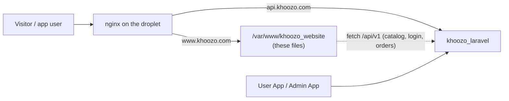

# Khoozo — Website

The company website and storefront for **Khoozo** (IT & Software, Real Estate, Travel, Training and a Shop), built with HTML, CSS and vanilla JavaScript. There's no framework or build step, so the files deploy as a static site.

Login, items, reviews and order checkout come from the shared **[khoozo_laravel](https://github.com/mahbub06ru4/khoozo_laravel)** API at `https://api.khoozo.com`.

---

## 🗂 Project structure

```
/
├── index.html             Home: hero, about, services, shop, reviews, contact
├── it.html                IT & Software Development
├── realestate.html        Real Estate
├── travel.html            Travel
├── training.html          IT & Freelancing Training
├── course.html            Course details
├── product.html           Digital product details
├── project.html           IT project details
├── property.html          Property details
├── cart.html              Cart
├── favorites.html         Favorites, saved on this device
├── pay.html               Checkout
├── pay-gateway.html       Sandbox payment screen
├── pay-result.html        Payment result
├── login.html             Google sign-in and account page
├── admin.html             Website admin, unlinked for normal users
├── team.html, terms.html, privacy.html, 404.html
│
├── js/
│   ├── i18n.js            English and Bangla text
│   ├── nav.js             Services menu and Home review slider
│   ├── auth.js            Google sign-in and account page
│   ├── catalog.js         Loads items from the API over the built-in lists
│   ├── admin.js           Website admin page
│   ├── products.js, training.js, projects-data.js   Built-in items and their pages
│   ├── cart.js, favorites.js, detail.js
│   └── main.js, animation.js
│
├── css/                   style, responsive, animation, products, training
└── assets/                Images and project screenshots
```

---

## 🔌 How it connects to the backend

| Feature | Where the data lives | If the API is unreachable |
|---|---|---|
| Items (Training, IT, Digital, Real Estate) | `catalog_items` | Shows the last-loaded or built-in items |
| Home reviews | `customer_reviews` | Review section stays hidden |
| Login | `users`, through `POST /auth/google` | Sign-in shows an error |
| Cart and favorites | This browser's localStorage | Keeps working |
| Checkout | See below | See below |

- **Local testing:** run the API on port 3200, or add `?apiPort=3210` to a page once to use another port for that tab.
- **Another API domain:** change `https://api.khoozo.com` in `js/auth.js`, `js/catalog.js` and `js/nav.js`.

### Sign-in

Everyone signs in with Google, using the Web client ID at the top of `js/auth.js`. It isn't a secret. Each site address must be listed under **Authorized JavaScript origins** in Google Cloud.

The backend's `ADMIN_EMAILS` and `MANAGER_EMAILS` settings decide who's staff. Admins see **Manage website** on their account page. Managers and normal users don't, and the API refuses them.

### Managing content

Sign in as an admin and open `admin.html`:

- **Items:** choose a category, then enter the text, price, category details and images.
- **Reviews:** add real customer reviews, with their permission.

Changes appear on the next page load. Items can also be managed in the Admin App, which covers the main fields, price and images.

### ⚠️ Checkout before launch

`KHOOZO_PAY.apiBase` in `js/training.js` is empty, so checkout runs in **sandbox mode**: the card and bKash screens are simulated and show a fake success, and orders aren't saved. Set it to `https://api.khoozo.com` before taking real orders. Gateway payments also need SSLCommerz credentials on the backend.

---

## 🚀 Deploying

The site is static (no build step), so it can live on the **same DigitalOcean droplet** as the backend, with nginx serving these files and `khoozo_laravel` behind the same server:



**On the droplet (one time):**

```bash
sudo git clone https://github.com/mahbub06ru4/khoozo_website.git /var/www/khoozo_website
```

Add `/etc/nginx/sites-available/khoozo-website` and enable it:

```nginx
server {
    listen 80;
    server_name khoozo.com www.khoozo.com;
    root /var/www/khoozo_website;
    index index.html;
    location / { try_files $uri $uri/ =404; }
}
```

```bash
sudo ln -s /etc/nginx/sites-available/khoozo-website /etc/nginx/sites-enabled/ && sudo nginx -t && sudo systemctl reload nginx
```

```bash
sudo certbot --nginx -d khoozo.com -d www.khoozo.com
```

Point the `khoozo.com` and `www` DNS records at the droplet, and add both `https://` addresses to **Authorized JavaScript origins** for the Web client in Google Cloud.

**Updating:** `cd /var/www/khoozo_website && sudo git pull`. Content changes (items, prices, images, reviews) need no deploy at all: they are entered in `admin.html` or the Admin App and stored by the backend.

**Alternative:** DigitalOcean App Platform → *Static Site* from this repo (free, auto-deploys on push). The `CNAME` file is only used by GitHub Pages.

The whole system (apps, website, backend, roles, launch checklist) is mapped in [ARCHITECTURE.md](https://github.com/mahbub06ru4/khoozo_laravel/blob/main/docs/ARCHITECTURE.md); backend setup is in the [deploy guide](https://github.com/mahbub06ru4/khoozo_laravel/blob/main/docs/DEPLOY_DIGITALOCEAN.md).

---

## 🖼 Adding IT project screenshots

**New screenshots:** upload them in `admin.html`. This older method only updates the built-in fallback.

Each IT project's page shows a screenshot slider, generated
from whatever files sit in `assets/it/<project-id>/`. Project ids: `khoozo`,
`dorkari`, `office`, `realestate-saas`, `travel-saas`, `fintrack`.

1. Drop screenshots (`.png`/`.jpg`/`.jpeg`/`.webp`) into the matching
   `assets/it/<project-id>/` folder — any filenames work, they sort naturally.
2. Rebuild the manifest: `node scripts/build-it-gallery.js`
3. Commit `assets/it/gallery.js` along with the new images, and push.

No HTML/JS editing needed — `js/main.js` reads `assets/it/gallery.js` at
runtime, so the slider picks up whatever the script finds.

---

## ✏️ Things to customize before launch

These are placeholder values used to complete the design — **replace them
with real information before publishing:**

| Item | Location | Notes |
|---|---|---|
| `team.html` testimonials | `team.html` → `#testimonials` | Still sample quotes. Replace them with real ones before launch. Home reviews come from `admin.html` |
| Team/company photos | `index.html` → `.chairman-avatar` | Currently an initials placeholder (`MR`) — replace with a real `` if you have a photo |
| Social links | Header, footer, Chairman section | Facebook is linked to `khoozo`. Update LinkedIn and GitHub to your real profile URLs |
| WhatsApp / Messenger links | Footer, floating action buttons | WhatsApp is linked to `+8801818120900`. Update `m.me/` with your real Messenger username |
| Google Maps embeds | Projects section, Contact section | Currently placeholder `<div>`s — replace with a real `<iframe>` using your Google Maps "Embed a map" URL |
| OG image | `<meta property="og:image">` in `<head>` | Points to `images/og-image.jpg`, which doesn't exist yet — add a 1200×630 social preview image |
| Domain in meta tags | `<head>` (`canonical`, `og:url`, JSON-LD, sitemap.xml, robots.txt) | Currently `https://mahbub06ru4.github.io/khoozo/` — update if you use a custom domain |
| Statistics | Hero stats, Counter section | Currently illustrative figures (150+ projects, 320+ clients, etc.) — replace with your real numbers |

---

## 🎨 Design system reference

All design tokens live at the top of `css/style.css` as CSS custom
properties on `:root` (and overridden under `[data-theme="dark"]` for dark
mode). Key tokens:

- **Colors:** `--navy` (#0A3D91), `--green` (#26A65B), plus soft tints and
  dark-mode equivalents
- **Type:** `--font-display` (Fraunces), `--font-body` (Inter),
  `--font-mono` (IBM Plex Mono, used for stats/data)
- **Radius/shadow/motion:** `--radius`, `--shadow-md`, `--ease`, etc.

Changing a brand color, font, or corner radius sitewide only requires
editing the relevant variable once.

---

## ♿ Accessibility & performance notes

- Skip-to-content link, visible focus rings, and semantic landmarks throughout
- All decorative SVGs/icons marked `aria-hidden="true"`; interactive icons have `aria-label`s
- Full `prefers-reduced-motion` support — disables the orbit animation, floating shapes, plane path, preloader animation, and scroll-reveal transitions for users who've requested reduced motion
- No external dependencies besides Google Fonts and Font Awesome (both CDN-hosted, both optional to swap for self-hosted versions if you want a fully offline-capable build)

---

## 📬 Contact form behavior

The contact form doesn't use the backend. It validates input in the browser, then opens the
visitor's email client with a pre-filled message via a `mailto:` link.

The current recipient is `mahbub06ru4@gmail.com`. If you'd prefer true in-page submission (no email client popup), swap the
`mailto:` logic in `js/main.js` (see the comment above the `form.addEventListener("submit", ...)` block) for a `fetch()` POST to a form backend
service such as Formspree, Getform, or a custom serverless function.

---

© 2026 Khoozo. 
# khoozo
