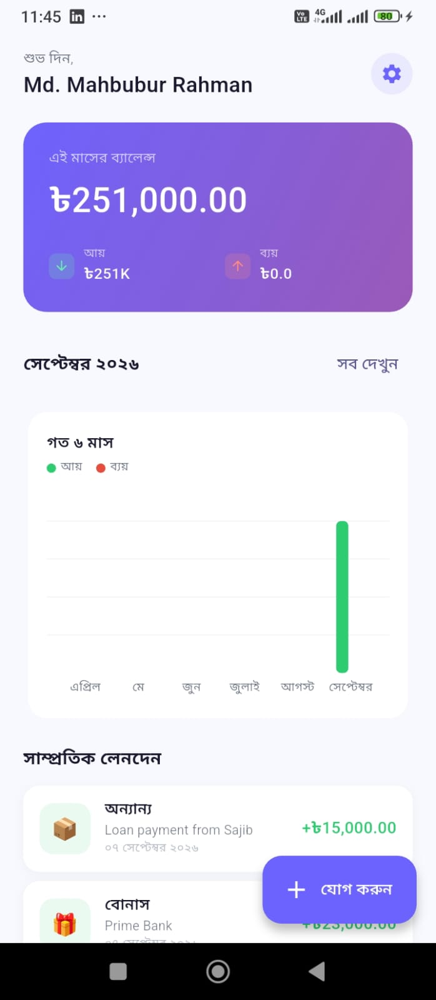
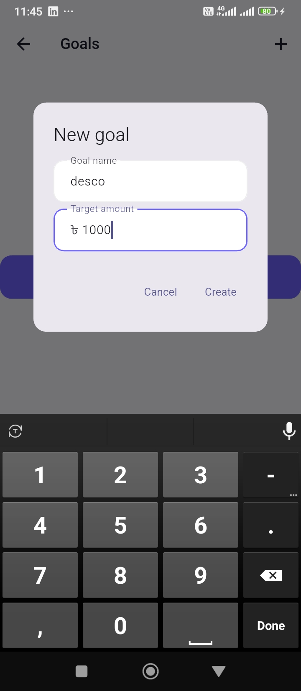
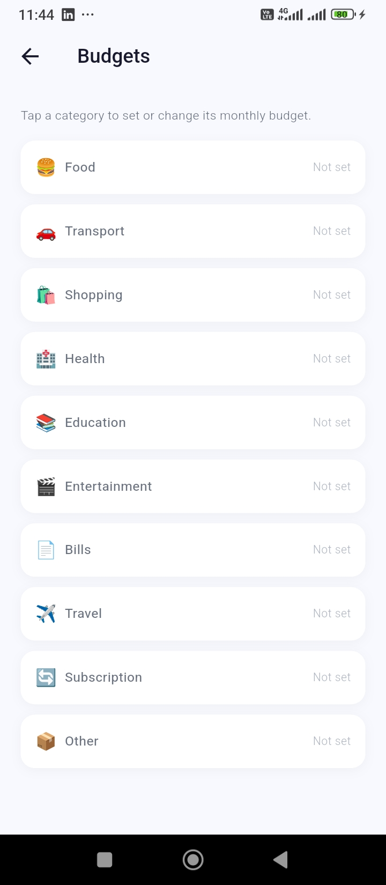
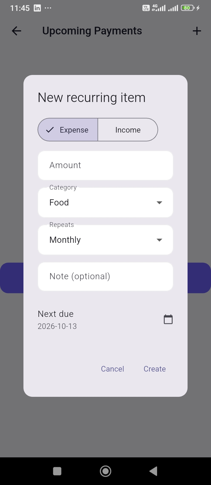
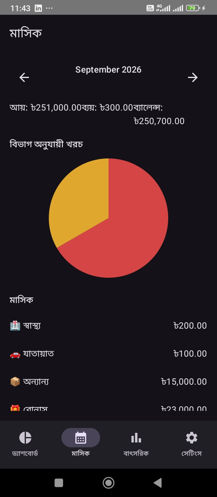
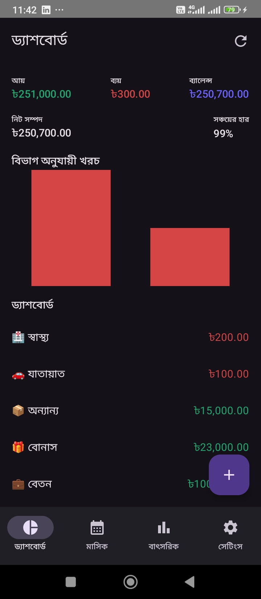
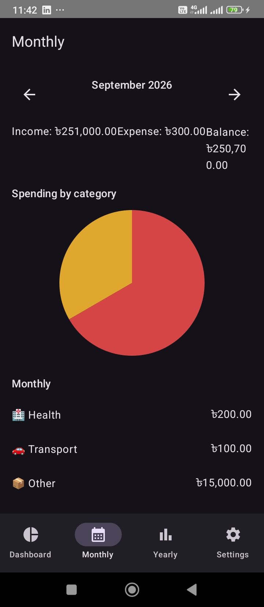
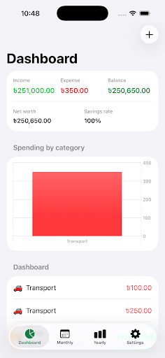
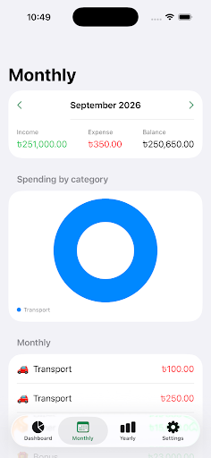
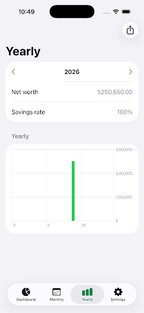

# FinTrack — Portfolio Summary

An **offline-first personal finance platform**, built three times over: a production **Flutter** app, a **native iOS** client (Swift/SwiftUI), and a **native Android** client (Kotlin/Jetpack Compose) — all backed by one self-hosted **NestJS + PostgreSQL** API. (The repo also includes a fourth, React Native client — see the main [README](../README.md) if that's relevant.)

- **Live backend:** [fintrack-api-ltwp.onrender.com/docs](https://fintrack-api-ltwp.onrender.com/docs) (Swagger)
- **Live web demo (Flutter):** [mahbub06ru4.github.io/flutter_expin](https://mahbub06ru4.github.io/flutter_expin/)
- **Source:** this repository — `flutter/`, `ios/FinTrackiOS/`, `android/FinTrackAndroid/`, `backend/`

---

## What it does

Income/expense tracking with budgets, goals, recurring payments, CSV/PDF export, push notifications, and full English/Bangla localization — synced offline-first across devices against a real Postgres backend, with Google Drive kept as a permanent backup.

## Why it's more than a CRUD app

- **The same offline-first sync engine, independently implemented three times** — an outbox queue, per-record delta sync, exponential backoff, and version-gated conflict resolution, written once in Dart (Flutter), once in Swift (iOS), once in Kotlin (Android). It's an architecture that translates across platforms, not one API wearing three skins.
- **Dual-write design** — one Google sign-in writes to Postgres (primary) and Google Drive (permanent backup) at once; the sync engine's remote target is pluggable, so this needed no changes to the outbox/worker itself.
- **Real, deployed infrastructure** — a live NestJS/Postgres backend (JWT auth, rotating refresh tokens), CI/CD with e2e tests against an ephemeral database, rate limiting and security headers in production — not code that only compiles.
- **Security-conscious by default** — AES-256 encryption at rest, Keychain/Keystore-backed credential storage on every platform.
- **Live-verified, not just built** — Google Sign-In was confirmed end-to-end against the deployed backend on both native clients; in the process, a real backend bug (OAuth audience validation) was found and fixed.

## Platform notes

**Flutter** (production client) — GetX (state/DI/routing), Hive (local cache), `fl_chart`, `flutter_secure_storage`, Clean Architecture (domain/data/presentation). Full feature set: budgets, goals, recurring transactions, dual-write sync, EN/BN localization, responsive UI.

**Native iOS** — Swift, SwiftUI with `@Observable` MVVM, SwiftData for local persistence/outbox, Keychain-backed JWT storage. Xcode project generated via XcodeGen. Same core scope as Android, minus budgets/goals/recurring (a deliberate cut — see `docs/adr/0011`).

**Native Android** — Kotlin, Jetpack Compose, Hilt (DI), Room (local DB + outbox), Retrofit/OkHttp, `EncryptedSharedPreferences`. Same scope as iOS (see `docs/adr/0012`). Real Gradle project — builds clean, passes its unit test suite, installable APK.

## Screenshots

10 screenshots below, also available at full resolution in [`docs/screenshots/`](../docs/screenshots/) (which has more per platform, plus infrastructure consoles).

**Flutter**

**Native Android**

**Native iOS**

---

*For the full engineering story — architecture decisions, phased build log, and the fourth (React Native) client — see the [main README](../README.md) and [`docs/adr/`](../docs/adr/).*
